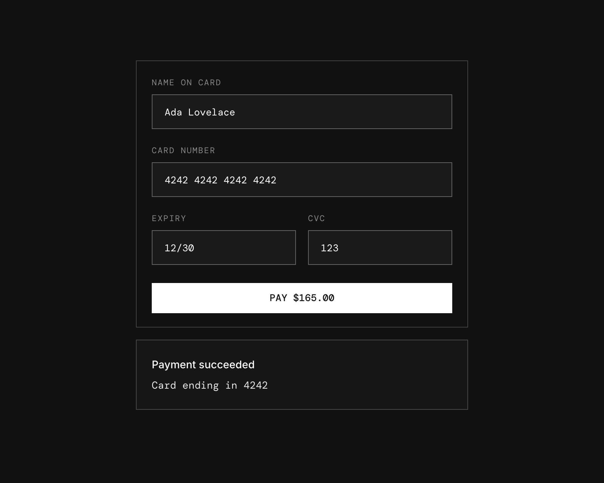

# e2e-iframe

A card checkout built from nested iframes, used as an example of end-to-end testing iframe-heavy UIs with [e2e](https://www.npmjs.com/package/e2e).



## How it works

The page is set up like a hosted payment form such as Stripe Elements:

- **Host page** (`app/page.tsx`) embeds the card form in an iframe and shows the payment result.
- **Card form** (`app/embed/card`) handles validation, submission, and the Pay button.
- **Card fields** (`app/embed/field/[field]`): each input (name, number, expiry, CVC) is rendered in its own nested iframe.

Like a real payment provider, the card form and fields load from a different origin than the host page (see [Two origins](#two-origins)). The frames talk to each other with `postMessage` calls, and the host and card form check each other's origin. The message types are defined in `lib/checkout-messages.ts`.

### Test cards

| Card number           | Result   |
| --------------------- | -------- |
| `4242 4242 4242 4242` | Accepted |
| `4000 0000 0000 0002` | Declined |

Use any future expiry date (`MM/YY`) and a 3–4 digit CVC.

## Getting started

```bash
npm install
npm run dev
```

Open [http://localhost:3000](http://localhost:3000).

### Two origins

One dev server answers on two hostnames, which the browser treats as separate sites:

- Host page: `http://localhost:3000` (`NEXT_PUBLIC_HOST_ORIGIN`)
- Card iframes (`/embed/*`): `http://127.0.0.1:3000` (`NEXT_PUBLIC_CARD_ORIGIN`)

Open the host page on `localhost`; on `127.0.0.1` it would share the card's origin. If you run on another port, set both variables to match, for example:

```bash
NEXT_PUBLIC_HOST_ORIGIN=http://localhost:3100 NEXT_PUBLIC_CARD_ORIGIN=http://127.0.0.1:3100 npm run dev -- -p 3100
```

## End-to-end tests

The tests in `tests/checkout.e2e.ts` combine `agent.act` / `agent.assert` steps with exact Playwright locators that reach into the iframes.

The agent model goes through the Vercel AI Gateway, so set `AI_GATEWAY_API_KEY` (or link a Vercel project). Then, with the dev server running:

```bash
npm run test:e2e
```

To test a different URL, set `APP_URL`. Configuration lives in `e2e.config.ts`.

## Scripts

| Command            | Description          |
| ------------------ | -------------------- |
| `npm run dev`      | Start the dev server |
| `npm run build`    | Build for production |
| `npm run lint`     | Run ESLint           |
| `npm run format`   | Format with Prettier |
| `npm run test:e2e` | Run the e2e tests    |
